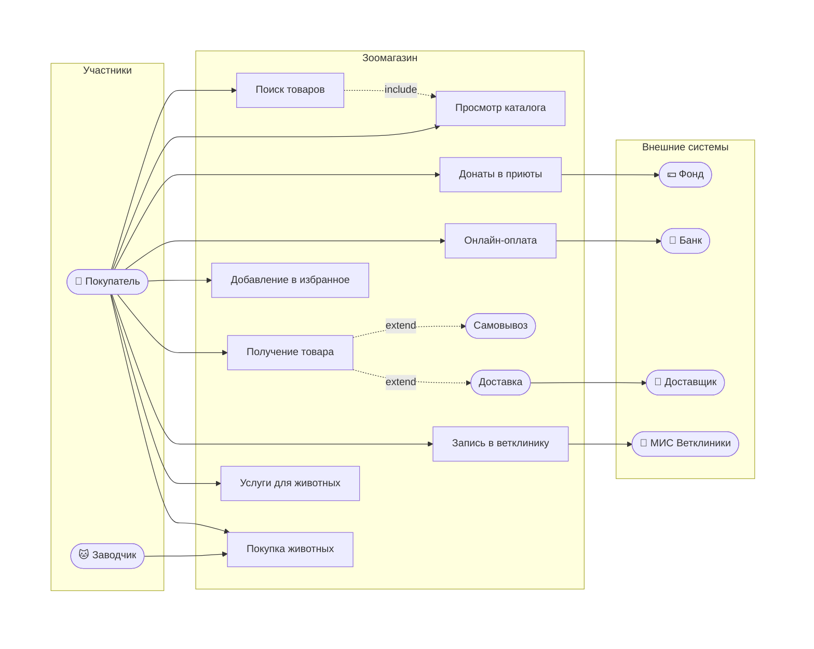

# Проект: Интернет-магазин зоотоваров «Zoo Market»

## 1. Общая информация о заказчике

**Zoo Market** — интернет-магазин для продажи зоотоваров. Компания работает на Дальнем Востоке и планирует выход на Центральную Россию. Располагает крупной сетью магазинов «Зоология»: 5 крупных городов, всего 20 торговых точек.

**Текущий опыт интернет-продаж:** полгода через соцсети и мессенджеры. Накоплена клиентская база — 1 500 человек. С этой базой планируется запуск маркетплейса.

**Инвестор:** Маша Собачкина — имеет большой опыт вывода маркетплейсов на рынок.

**Бюджет на горизонт 2 лет:** 15–20 млн рублей.

**Платформа:** разрабатывается веб-сайт.

---

## 2. Цель проекта

Запустить интернет-магазин зоотоваров с последующим развитием в полноценную платформу зооуслуг. Стартовый этап — продажа товаров для животных, далее — поэтапное наращивание функционала.

---

## 3. Функционал проекта

### 3.1. Базовый функционал (ядро системы)

1. **Продажа еды для животных** — основной товарный сегмент.
2. **Продажа сопутствующих товаров** — поводки, шлейки и т.д.
3. **Донаты для приютов** — раз в месяц денежные средства перечисляются на выбранный пользователем приют.
4. **Продажа породистых животных от заводчика** — кошки и собаки, объявления о продаже.
5. **Запись в ветеринарные клиники** — партнёрские клиники.
6. **Услуги для животных** — стрижка, выгул.

### 3.2. Дорожная карта развития (2 года)

| Срок | Функционал |
|------|-----------|
| 0–3 месяца | Продажа товаров для животных |
| 3–6 месяцев | Донаты в приюты, продажа щенков |
| 1 год | Запись в ветеринарную клинику |
| 1,5 года | Услуги для животных |
| 2 года | Выход на Центральную Россию |

---

## 4. Требования к системе

### 4.1. Функциональные требования

- **Интеграция с 1С** — выгрузка каталога товаров из 20 магазинов сети.
- **Интеграция с курьерской службой** — доставка заказов.
- **Способы получения заказа:** самовывоз из магазина или доставка курьером.
- **Система уведомлений** — push-уведомления и SMS.
- **Система лояльности** — накопительные скидки и т.д.
- **Идентификация клиента** — по номеру телефона.
- **Онлайн-оплата** — только безналичный расчёт через интернет.
- **Рекомендательная система** — фиксация действий пользователя (покупки, лайки) для формирования персональных рекомендаций.

### 4.2. Нефункциональные требования

- **Масштабируемость** — система должна выдерживать рост нагрузки при выходе на новые регионы.
- **Надёжность** — бесперебойная работа сервиса.
- **Облачное размещение** — собственных мощностей для поддержки сайта нет, планируется использование облачной инфраструктуры.

---

## 5. Диаграмма вариантов использования (Use Case)

**Участники:**
- **Покупатель** — основной пользователь системы.
- **МИС Ветклиники** — медицинская информационная система партнёрской клиники (интеграция для записи).

**Основные сценарии:**
- Поиск и просмотр каталога товаров.
- Донаты в приюты.
- Онлайн-оплата товаров.
- Добавление товаров в избранное.
- Получение товара (самовывоз / доставка).
- Запись в ветклинику (с интеграцией в МИС клиники).
- Запись на услуги для животных.
- Покупка животных.

---

## 6. Ожидаемые результаты

1. Запуск веб-сайта интернет-магазина с продажей зоотоваров в первые 3 месяца.
2. Поэтапное подключение донатов, продажи животных, записи в ветклиники и услуг для животных в течение 2 лет.
3. Интеграция с 1С (каталог из 20 магазинов) и курьерской службой.
4. Работающая система лояльности, уведомлений и рекомендаций.
5. Выход на рынок Центральной России к концу двухлетнего горизонта.